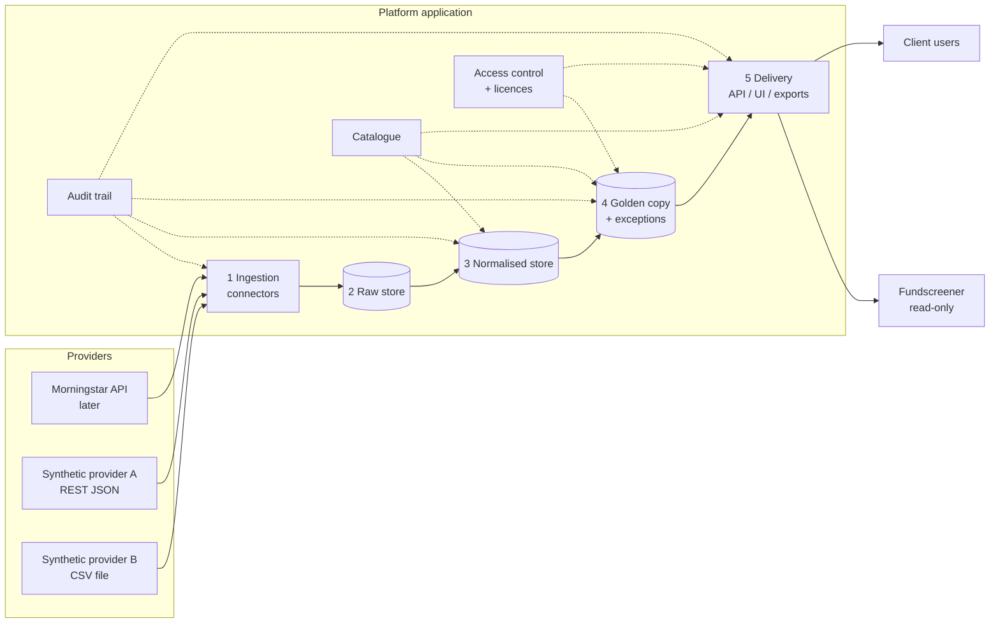

# Architecture

Status: **proposal, to be validated by the IT Lead.** Open decisions are numbered
`A-xx` and listed in [assumptions.md](assumptions.md).

## 1. Overview

Two services in one repository, sharing one PostgreSQL database, deployed with Docker on
FinFiles' own Linux servers (decision C-07):

| Service | Stack | Owns | Layers |
|---|---|---|---|
| `core` | Java + Spring Boot | Database schema (Flyway), all writes to data tables, scheduled ingestion, golden copy computation | 1–4, catalogue loading, audit writes |
| `web` | PHP + Laravel | Public REST API (incl. Fundscreener), web interface, users/roles/API tokens, scheduled exports | 5, access control UI |

Rules between the services:
- `core` is the **only writer** of client data tables and the only service that runs
  migrations. `web` connects with a read-only role per client schema.
- `web` sends changes (manual corrections, priority overrides, exception decisions) to
  `core`'s **internal REST API**, which validates, writes and audits them (A-28). The
  internal API is not exposed outside the server network.
- Both services enforce the tenant context and licences; tests in both cover isolation.
- Fundscreener only talks to `web`'s public API.

## 2. Layers

### 2.1 Ingestion
- One **connector** per provider, implementing a common interface:
  `fetch(request) -> Iterable[RawPayload]`, where `RawPayload` carries the bytes,
  content type, source reference (URL or file name) and `received_at`.
- Two connector families: **API** (pull over HTTPS) and **file** (drop folder / SFTP).
- Connectors know transport and authentication only. They never interpret fields;
  that is the job of mapping configuration.
- Each run is recorded as an `ingestion_run` (who/what triggered it, status, counts).
- Credentials come from environment variables or a secret file mounted at runtime,
  never from the repository or the database in clear text (A-12).

### 2.2 Raw store
- Every payload stored **exactly as received** (bytes + SHA-256 hash), append-only.
- Immutability is enforced in the database: the application role has `INSERT`/`SELECT`
  only, and a trigger rejects `UPDATE`/`DELETE`.
- Re-processing (e.g. after a mapping fix) always starts from the raw store, so no
  provider call is needed to rebuild history.
- Payloads are stored in PostgreSQL (`bytea`) at first; move to a file/object store
  if volumes require it (A-08).

### 2.3 Normalised store
- A **mapper** reads a raw payload and the provider's mapping configuration
  (`config/mappings/<provider>.yaml`) and produces normalised values:
  `(entity, data_point, source, effective_date, received_at, value, raw_payload_id)`.
- Mapping configuration covers: field paths, identifier scheme, unit/currency
  conversion, code lists (e.g. provider fund type → canonical code), date parsing.
- The mapping config version (git commit hash + file hash) is stored on each value.
- Values that fail mapping (unknown field, bad type) become **exceptions**, not silent drops.
- Append-only: a new delivery of the same value adds a row with a newer `received_at`.

### 2.4 Golden copy
- For each `(entity, data_point, effective_date)` the **resolver** picks one value from
  the available sources, using the most specific priority rule:
  1. data point override for this client,
  2. client override,
  3. global default (`config/priority/default.yaml`).
- Only sources the client is **licensed** for are candidates (see 2.6).
- `MANUAL` is a source like any other; by default it ranks first (A-06).
- Rule: take the highest-priority source that has a value passing quality checks.
  Fallback to the next source is logged with the reason.
- **Quality checks** (configured per data point in the catalogue): required, type, range,
  allowed values, NAV day-on-day move threshold, cross-source divergence tolerance,
  staleness. A failing check creates an entry in the **exception queue**.
- Each golden value records which normalised value it came from, which rule level and
  rule version decided, and `computed_at`. Golden values are versioned (append-only),
  so the golden copy as it was at any time can be reproduced.

### 2.5 Delivery
- **REST API** (Laravel in `web`, OpenAPI 3 spec published as the contract for
  Fundscreener and client systems). Read-only endpoints for golden values, with optional
  `as_of_date` (effective) and `known_at` (received/computed) parameters. Lineage
  endpoint shows candidate values and why one was chosen.
- **Web interface** (Laravel Blade, server-rendered) for data stewards: browse
  values, lineage, resolve exceptions, enter manual corrections, manage overrides.
- **Scheduled exports**: CSV/XLSX/JSON snapshots per client, written to an SFTP
  or drop folder (A-14).
- Every API call is scoped to exactly one client by its credential.

### 2.6 Supporting functions
- **Data point catalogue**: canonical code, label, type, unit, entity level
  (fund / share class), temporal kind (static / time series), standard reference
  (EMT/EPT/EET/openfunds), quality checks. Defined in `config/catalogue/*.yaml`,
  loaded into the `platform` schema.
- **Audit trail**: append-only `audit_event` per client schema for every write action
  (ingestion runs, corrections, override changes, exception resolution, logins,
  API access summaries). Supports ISO 27001 A.8.15 (logging).
- **Access control**: users, roles (viewer, data steward, client admin, FinFiles
  operator), API clients (machine credentials). **Licences** per client and provider
  with validity dates.

## 3. Multi-tenancy

- PostgreSQL schemas:
  - `platform`: clients, providers, licences, catalogue, users, API clients,
    configuration snapshots. **No client fund data.**
  - `client_<code>`: one per asset manager, created from the same migration template.
    Holds raw payloads, normalised values, golden values, overrides, corrections,
    exceptions, audit events.
- Isolation, defence in depth (A-04):
  1. one PostgreSQL role per client schema with privileges only on that schema
     (plus read-only on needed `platform` tables);
  2. each request/job opens a transaction with `SET LOCAL ROLE client_<code>` and
     `SET LOCAL search_path = client_<code>`;
  3. the data access layer takes a `TenantContext` and refuses queries without one;
  4. automated tests try cross-client reads and must fail.
- Consequence: provider data fetched for two clients is stored twice. This is accepted,
  because providers like Morningstar licence per client and may require the client's
  own credentials (A-03).

## 4. Bitemporal model and reproducibility

- `effective_date`: the business date the value applies to (NAV date, fee valid-from).
- `received_at`: when the platform received the payload (from the raw payload).
- Golden values add `computed_at`.
- "What did we deliver for share class X on date D, as known at time T?" =
  golden value with `effective_date = D` (or latest ≤ D for static data) and
  `computed_at ≤ T`, latest first. Configuration versions are stored with each row,
  so the decision can be explained as well as reproduced.
- Nothing is updated in place in the data layers. Corrections are new rows.

## 5. Configuration

| What | Where | Changed by |
|---|---|---|
| Catalogue | `config/catalogue/*.yaml` (git) | FinFiles, via PR |
| Mappings per provider | `config/mappings/*.yaml` (git) | FinFiles, via PR |
| Global priority default | `config/priority/default.yaml` (git) | FinFiles, via PR |
| Client / data point priority overrides | `priority_override` table in client schema | Client admin via UI/API, audited |
| Licences | `platform.licence` | FinFiles operator, audited |

Config files are validated against a JSON schema at startup and in CI (A-07).

## 6. Deployment

- Docker images: `core` (Spring Boot, runs ingestion and golden copy jobs), `web`
  (Laravel behind nginx + PHP-FPM, plus a queue/scheduler container for exports),
  PostgreSQL 16.
- Docker Compose for local development; same images on Linux servers.
- Scheduling: Spring scheduler in `core` for ingestion, Laravel scheduler in `web` for
  exports (A-10). No managed cloud services.
- Backups: PostgreSQL base backups + WAL archiving (A-15).

## 7. Out of scope for the first release

EET/ESG data, holdings/look-through, real-time streaming, client-specific code in the
platform, write access for Fundscreener.
